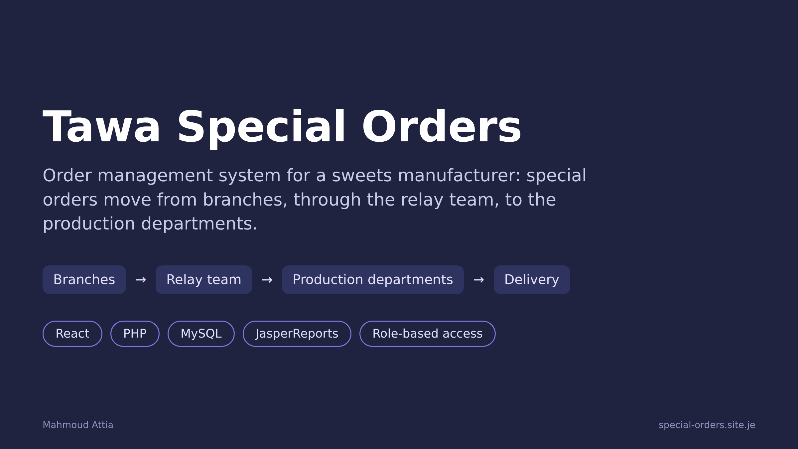
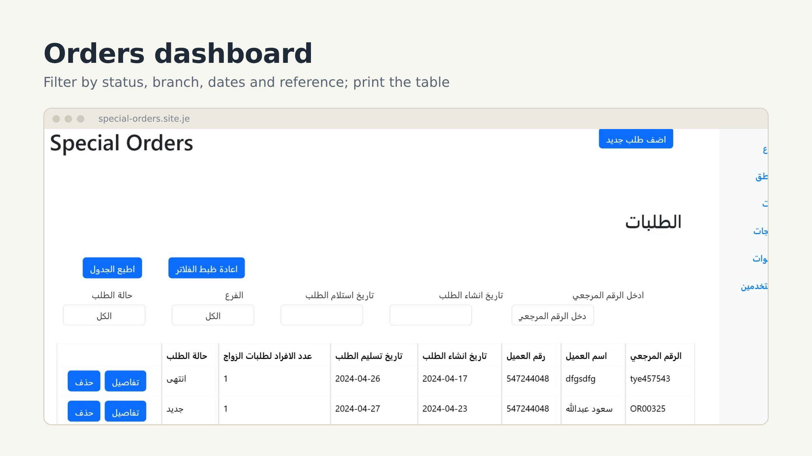
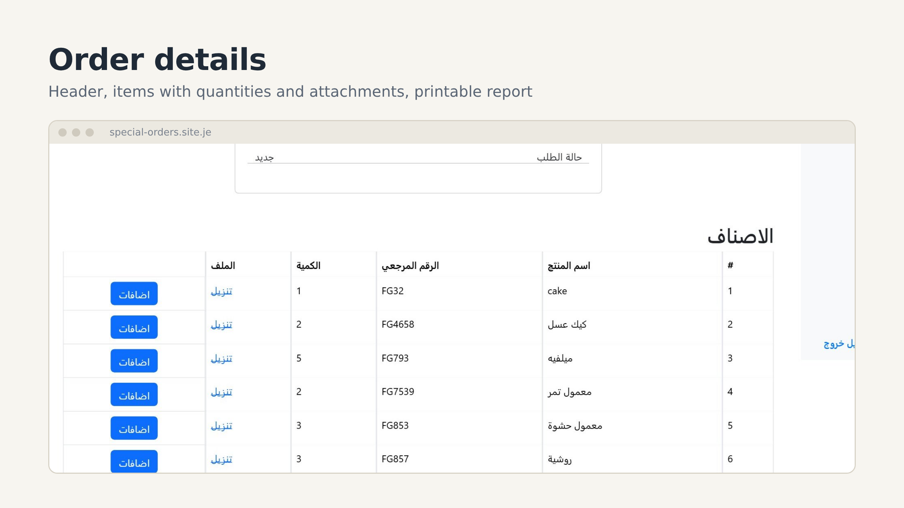
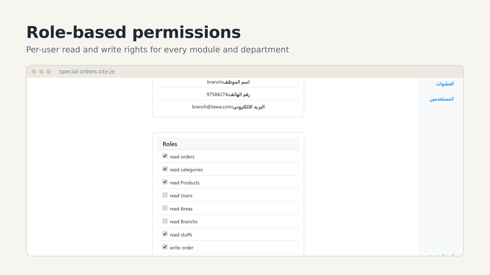
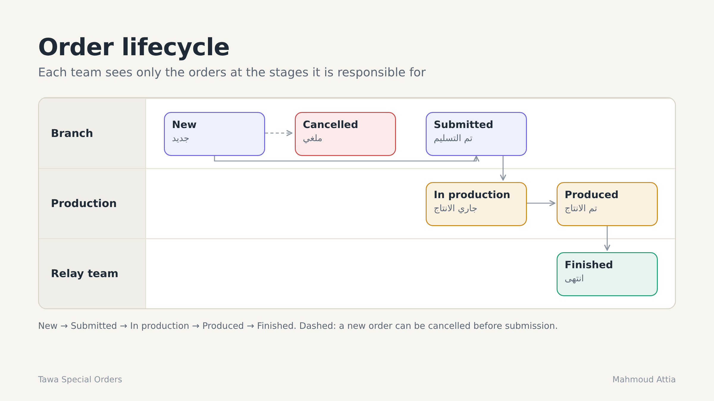
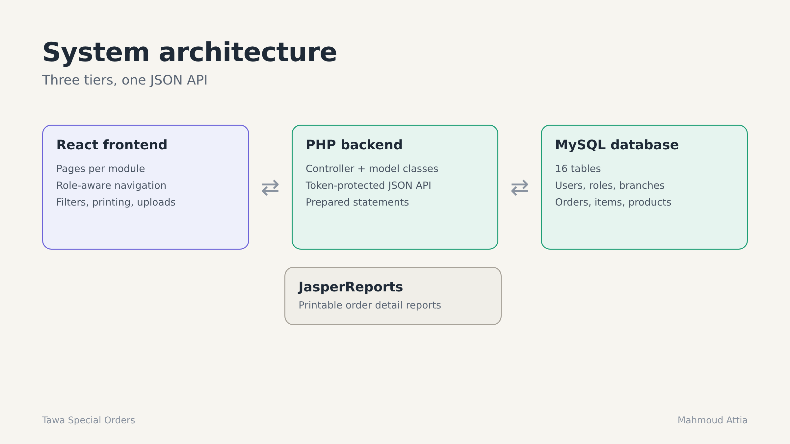
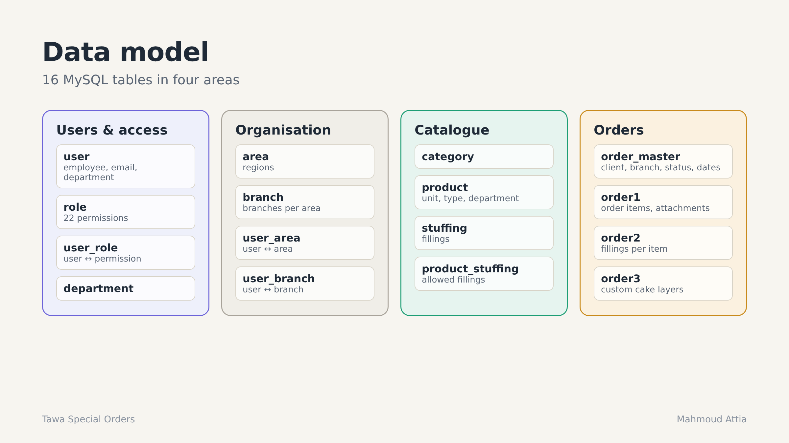

# Tawa Special Orders

An order management system built for **Tawa Sweets Company** (Riyadh) to run special orders end to end: from the branches, through the relay team, to the production departments.

**Live demo:** [special-orders.site.je](https://special-orders.site.je) · demo login available on request



## The problem it solves

Special orders (custom cakes, large quantities, wedding orders) pass between the branches, a relay team and several production departments. The system gives every team one place to create, follow and hand over these orders, shows each department only the work it is responsible for, and gives managers reports on each order.

## What the system does

- **Order lifecycle tracking:** every order moves through clear stages: New → Submitted → In production → Produced → Finished (or Cancelled).
- **Role-based access:** 22 read/write permissions per user. Each production department (cakes, Arabic sweets, coffee, pastries, chocolate) only sees the orders at the stages it handles.
- **Detailed orders:** items with quantities, fillings per item, multi-layer custom cakes (size, filling and text per layer) and file attachments.
- **Organisation setup:** areas, branches, product categories, products and allowed fillings, all managed from the app.
- **Filtering and reporting:** filter orders by status, branch, dates and reference; print tables and order detail reports (JasperReports).

## Screenshots

| Orders | Order details | Permissions |
|---|---|---|
|  |  |  |

## How it works

### Order lifecycle



### Architecture



- **Frontend:** React (Create React App), React Router, React Bootstrap, Axios.
- **Backend:** PHP with a controller/model structure exposing a JSON API.
- **Database:** MySQL / MariaDB, 16 tables.
- **Reports:** JasperReports through PHPJasper (needs Java; the free hosting of the live demo can't run it, so reports work when running locally).

### Data model



## Security

- Passwords are stored as bcrypt hashes (`password_hash`), and existing plain-text passwords are upgraded automatically on the next login.
- Every API call (except sign-in) requires a signed, expiring login token sent in the `X-Auth-Token` header.
- Write actions are also checked on the server against the user's permissions, so a read-only user gets `403` even when calling the API directly.
- All database access goes through prepared statements with bound parameters (no SQL built from user input).
- The API never returns password fields.
- File uploads are limited to PDFs and images, and the uploads folder cannot run scripts.
- Database credentials live in `config/db_production.php` on the server only and are never committed.

## Project structure

```
config/                 Database connection, query helper, auth tokens
src/controller/         person.php: main JSON API (flags per action)
src/model/              One class per table group (orders, users, products...)
src/viewer/             React frontend
docs/images/            Diagrams and screenshots used in this README
```

## Run it locally

1. Install [XAMPP](https://www.apachefriends.org/) and put the project in `C:\xampp\htdocs\Tawa Management App`.
2. Start Apache and MySQL, create a database named `tawa_management_application` and import `docs/database.sql` (demo data; every demo user's password is `changeme`).
3. Install the PHP dependencies for reports: `cd src/model && composer install`.
4. Start the frontend:
   ```bash
   cd src/viewer
   npm install
   npm start
   ```
5. Open `http://localhost:3000`. Locally the app talks to XAMPP with the default `root` user.

## Deployment

The live demo runs on free PHP/MySQL hosting: the React build and the PHP backend are served from the same domain, so the frontend calls the API with relative paths. Server-only database settings go in `config/db_production.php` (see `config/db_production.example.php`).

## Author

**Mahmoud Attia**: built for Tawa Sweets after graduating.
[LinkedIn](https://www.linkedin.com/in/mattia1312)
